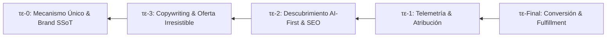

# Reverse Causality Methodology: Future Archaeology (Apoτέlοs)

Authoritative specification for the ontological and operational reversal of the causal chain ($\tau\epsilon$-Final $\to \tau\epsilon$-0).

---

## 1. Ontological Axiom

Traditional engineering and product design move forward in time:
$$\text{Idea} \longrightarrow \text{Brand} \longrightarrow \text{Code} \longrightarrow \text{Traffic} \longrightarrow \text{Sale}$$

In high-converting sovereign architecture, this order is an anti-pattern that leads to generic slop, disconnected messaging, and tracking blindness.

**Apotelos operates in reverse time (Future Archaeology)**:
$$\tau\epsilon\text{-Final (Venta Consumada)} \longleftarrow \tau\epsilon\text{-1 (Telemetría)} \longleftarrow \tau\epsilon\text{-2 (Descubrimiento)} \longleftarrow \tau\epsilon\text{-3 (Oferta)} \longleftarrow \tau\epsilon\text{-0 (Mecanismo)}$$

---

## 2. Reverse Execution Dominos

### Dominó 4 ($\tau\epsilon$-Final): Conversión y Fulfillment
- **Invariante**: Tratar la transacción como un hecho histórico ya ocurrido.
- **Entregables**: Monto de cobro exacto, moneda, pasarelas habilitadas (Wompi, COD, Stripe), webhooks de confirmación y flujo post-compra.

### Dominó 3 ($\tau\epsilon$-1): Telemetría y Atribución
- **Invariante**: Ningún pixel ni evento se inventa fuera de los datos de conversión.
- **Entregables**: Configuración de Meta CAPI (Server-to-Server), Google Ads Enhanced Conversions, TikTok Events API, Consent Mode v2 default denied, cookies 1st-party `__attr_session` a 90 días.

### Dominó 2 ($\tau\epsilon$-2): Descubrimiento AI-First y Autoridad Semántica
- **Invariante**: Los motores de IA (ChatGPT Search, Perplexity, Google SGE) y motores de búsqueda deben indexar entidades formales antes de que el usuario humano llegue.
- **Entregables**: `/llms.txt`, Schema.org `@graph` validado con `LocalBusiness` o `Product`, `ImageObject` con metadatos IPTC.

### Dominó 1 ($\tau\epsilon$-3): Copywriting y Oferta Irresistible
- **Invariante**: El copywriter no escribe desde inspiración poética; redacta contra las palabras clave de SEO y los eventos de telemetría.
- **Entregables**: Gancho de 3 segundos contra el dolor del avatar, promesa de transformación, contraste de alternativas de mercado y garantía de reversión de riesgo.

### Dominó 0 ($\tau\epsilon$-0): El Primer Dominó (Mecanismo Único)
- **Invariante**: Extraído de `00_category_of_one_playbook.md` y `brandbook.json`.
- **Entregables**: El vehículo propietario patentable o conceptualmente único que hace que la oferta sea incomparable (Categoría de Uno).
