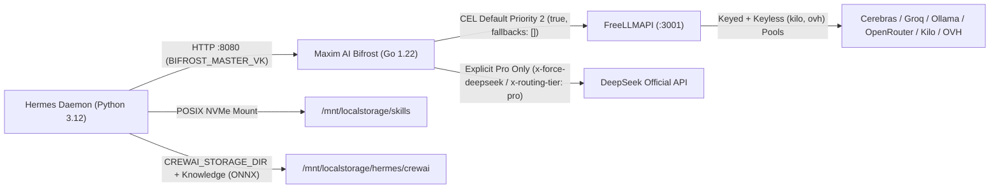

# CrewAI Engine: Infrastructure & Mesh Topology

## 1. Network Topology & Ports

## 2. Invariant Specifications

- **Container Runtime**: Hermes + embedded `crewai_engine` run in `ubuntu/python@3.12` LXC on Zerops.
- **Persistent Volume**: Mounted at `/mnt/localstorage` (`CREWAI_STORAGE_DIR=/mnt/localstorage/hermes/crewai`).
- **Inference Gateway**: Bifrost (`http://bifrost:8080/v1`) routes strictly to FreeLLMAPI (`fallbacks: []` unless `x-allow-paid-fallback: true` or `x-force-deepseek: true`).
- **Embedder Invariant ($0 Local ONNX)**: CrewAI's built-in `{"provider": "onnx"}` embedder (`KnowledgeLoader.build_embedder_config()`) embeds playbooks locally without needing `OPENAI_API_KEY` or Bifrost embedding routes.
- **Path Resolution Invariant**: All file paths passed to `TextFileKnowledgeSource` MUST be explicit `pathlib.Path` instances to avoid CrewAI's `knowledge/` string-prefix bug.
