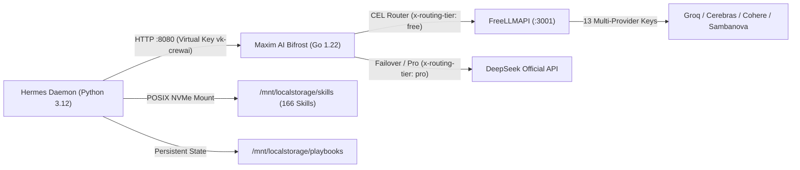

# CrewAI Engine: Infrastructure & Mesh Topology

## 1. Network Topology & Ports

## 2. Invariant Specifications

- **Container Runtime**: Hermes runs in Ubuntu 24/Python 3.12 LXC container on Zerops.
- **Persistent Volume**: Mounted at `/mnt/localstorage` (POSIX NVMe, single-kernel access).
- **Inference Gateway**: Bifrost (`http://bifrost:8080/v1`) provides sub-100us proxy latency with automatic provider failover and CEL routing.
- **Embedder Invariant**: CrewAI's `KnowledgeStorage` defaults to ChromaDB with OpenAI embeddings. An explicit `embedder` block pointing to `http://bifrost:8080/v1` is mandatory to avoid missing `OPENAI_API_KEY` runtime errors.
- **Path Resolution Invariant**: All file paths passed to `TextFileKnowledgeSource` MUST be explicit `pathlib.Path` instances. Passing string paths triggers CrewAI's internal `convert_to_path` bug that prepends `knowledge/` and throws `FileNotFoundError`.
