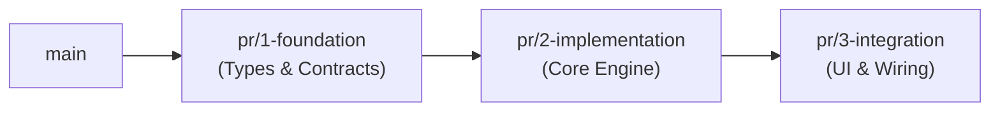

# `meta-gitops` — Usage & Implementation Guide

This guide establishes the operational procedures for atomic GitOps delivery, conventional commits, branch management, and repository synchronization under Supreme Directive v8.5.

---

## 1. Chained PRs & Atomic Work Units ($\le$ 400 Lines)

To maximize review throughput and minimize merge conflicts, large features must be decomposed into stacked, reviewable slices:



### Slicing Rules

1. **Strict 400-Line Ceiling**: Any PR exceeding 400 added/changed lines (excluding lockfiles) must be sliced into sequential work units (`chained-pr`).
2. **Independent Compilation**: Every chained slice must compile and pass test suites independently (`bun test`, `pytest`, `skills-suite-validate`).
3. **Linear Issue Anchoring**: Every branch and PR must reference its originating Linear issue (e.g. `BAI-349`).

---

## 2. Conventional Commits Standard (Zero AI Attribution)

All commits across the Zerops ecosystem must follow the Conventional Commits 1.0 specification:

```
<type>(<scope>): <short summary in imperative present>

[optional body explaining WHAT and WHY, never restating the diff]

[optional footer referencing Linear/GitHub issues: fixes BAI-123]
```

### Allowed Types

- `feat`: New feature or user-facing capability.
- `fix`: Bug fix or error resolution.
- `refactor`: Code reorganization with zero behavior change.
- `chore`: Maintenance, dependencies, or configuration updates.
- `docs`: Documentation, guides, or specifications.
- `test`: Adding or correcting tests.

### Forbidden Trailers

Never include AI attribution lines in commit messages:
- ❌ `Co-Authored-By: Claude <...>`
- ❌ `Generated with Gemini / Antigravity`
- ❌ `Assisted-by: AI`

---

## 3. Zero Live Edits Protocol in Zerops

Zerops runtime containers are stateless execution environments connected to managed infrastructure:

1. **Source of Truth in Git**: Production and preview workloads are deployed strictly from Git commits.
2. **No Untracked Shell Edits**: Never make manual changes inside runtime containers over SSH without committing them to the repository.
3. **Reproducibility**: If a configuration or dependency is required, record it in `zerops.yaml` or `prepareCommands` so it survives container restarts.
