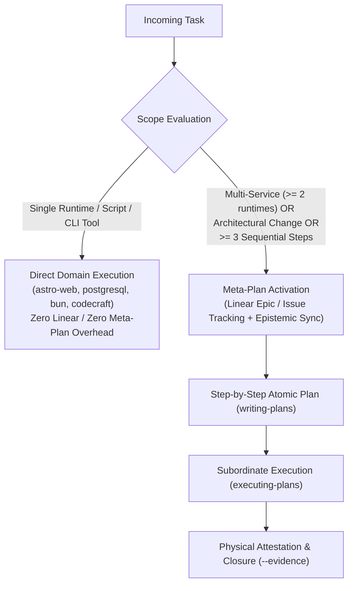

# `meta-plan` — Usage & Implementation Guide

This guide establishes the operational procedures for atomic planning, epistemic tracking, and proportional activation under Supreme Directive v8.5 and CoHaLo standards.

---

## 1. Proportional Activation Threshold (Zero-Friction vs Structured)

To eliminate unnecessary bureaucracy and token waste, all tasks must be routed according to the Proportional Activation Threshold:

### Routing Rules

| Scope Class | Execution Route | Justification |
|---|---|---|
| **Bounded Domain Task** (e.g. edit Astro component, fix SQL query, run `.bin/nlm-tutor`) | Direct Domain Skill (`astro-web`, `postgresql`, `bun`, `codecraft`) | No cognitive coordination overhead; direct edit and test execution. |
| **Multi-Service Initiative** (e.g. wire NATS between `brand` and `evolution`) | `meta-plan` + Linear Issue | Requires contract alignment across multiple runtime boundaries. |
| **Systemic Refactor / Architecture** (e.g. migrate storage, alter constitutional rules) | `meta-plan` + Linear Issue | High blast radius; requires explicit acceptance criteria and rollback points. |
| **Complex Task ($\ge 3$ Steps)** | `meta-plan` + Linear Issue | Prevents context drift and step omission during multi-turn execution. |

---

## 2. Epistemic Tracking Protocol

Chat context is ephemeral and prone to compaction. All architectural decisions, gotchas, and milestone outcomes must be persisted synchronously:

1. **Linear Comment (`linear-cli comment`)**:
   - Record what was discovered, why an approach was chosen, and which files were modified.
   - Run before replying in chat whenever an architectural crossroad is resolved.
2. **Engram Memory (`mem_save`)**:
   - Record durable discoveries, gotchas, and patterns for cross-session longevity.
   - Self-check: *"Did I make an architectural decision or uncover a non-obvious pattern?"* If yes, call `mem_save` immediately.
3. **Delivery Guarantee**:
   - Saving to memory or Linear is bookkeeping; always synthesize the user-facing answer clearly in the final turn message.

---

## 3. Subordinate Plan Execution Protocol

When executing a multi-step plan under `meta-plan`:

1. **Author the Plan (`writing-plans`)**:
   - Every task must specify: Purpose, Files to modify, Exact code diff or implementation, and Physical verification command.
2. **Execute Sequentially (`executing-plans`)**:
   - Never skip steps or batch changes without verification.
   - Execute one step at a time, verify with physical tests (`bun test`, `pytest`, `bash -n`), and check off the item.
3. **Stop on Blockers**:
   - If an unexpected error or breaking change occurs, STOP immediately. Do not attempt blind workarounds that mutate unapproved surfaces.

---

## 4. Systemic Root Cause Triage (`systemic-issue-triage`)

When encountering recurring bugs or backlog clusters:

1. **Map the Mechanism**: Trace the failure to its structural root rather than patching superficial symptoms.
2. **Deletion-Driven Fixes**: Prefer removing dead code, redundant shims, or duplicate configurations over adding defensive layers.
3. **Sovereign Verification**: Ensure the fix is permanently validated by the universal sensors (`skills-suite-validate` and `ssot-parity-check`).
