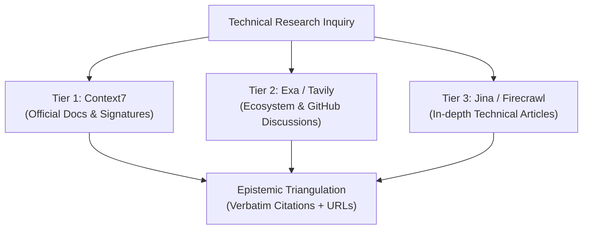

# `meta-research` — Usage & Implementation Guide

This guide establishes the operational procedures for multi-tier epistemic research, code intelligence lookup, and anti-AMN verification under Supreme Directive v8.5.

---

## 1. Context7 Code Intelligence Protocol

When evaluating NPM packages, Python modules, Go libraries, or framework APIs:

1. **Resolve Library ID**:
   - Query `context7 resolve-library-id` with the package name (e.g. `astro`, `nats.ws`, `bun`, `pydantic`).
   - Match the canonical identifier returned by the index.
2. **Fetch Targeted Documentation**:
   - Call `context7 query-docs` with specific technical keywords (e.g. "middleware lifecycle", "SSR adapter configuration").
   - Extract exact function signatures, argument types, and return types.
3. **Assert Verbatim Reality**:
   - Never assume API arguments based on similar frameworks. Rely exclusively on the documentation fetched in real time.

---

## 2. Multi-Engine Triangulation Protocol

For state-of-the-art benchmarks, library comparisons, or complex architectural trade-offs:

### Triangulation Rules

- **Two-Source Rule**: Any controversial architecture choice or newly released feature must be corroborated by at least two independent primary sources.
- **Timestamp Verification**: Always verify publication dates to avoid referencing obsolete patterns superseded by recent releases.
- **Grounding in Code**: Validate that claimed features exist in the target version before committing to an architectural direction.

---

## 3. Deep Extraction Protocol (Jina Reader & Firecrawl)

When technical documentation is locked behind bloated JavaScript rendering, anti-bot screens, or noise:

1. **Jina Reader (`r.jina.ai`)**:
   - Prefix any public URL with `https://r.jina.ai/` to retrieve clean, stripped Markdown directly.
   - Ideal for engineering blog posts, architectural deep dives, and whitepapers.
2. **Firecrawl (`firecrawl_scrape`)**:
   - Use for complex multi-page documentation or dynamic single-page applications.
   - Converts DOM into clean Markdown without adverts or extraneous navigation bars.

---

## 4. Anti-AMN Grounding Standards

1. **Primary Citations Required**: Every technical report or architectural finding delivered to the user must include verbatim quotes and canonical links.
2. **No Hallucinated Platform Quotas**: Zerops service specs, CPU modes (`SHARED`), and container limits must be queried live via `zerops_discover` or Zerops knowledge bases, never inferred.
