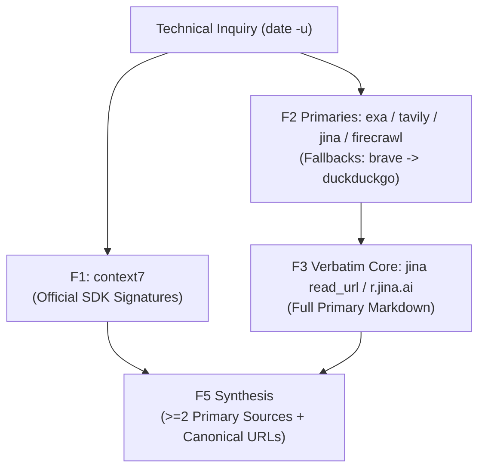

# `meta-research` — Usage & Epistemic Protocol Guide (v2.0)

Operational manual for multi-tier epistemic research, Jina verbatim grounding, and Anti-AMN compliance under Supreme Directive v9.0.

---

## 1. Context7 Code Intelligence Protocol (F1)

When evaluating NPM, PyPI, Crates, Go packages, or framework APIs:
1. Resolve the package slug via `context7:resolve-library-id`.
2. Query target features/migrations via `context7:query-docs`.
3. Extract exact method signatures, field names, and supported runtime versions verbatim before writing code or plans.

---

## 2. Multi-Engine Triangulation Protocol (F2 + F3)

For SOTA benchmarks, library comparisons, and architecture trade-offs:

### Triangulation Rules
- **Two-Source Rule:** Corroborate every SOTA recommendation or breaking change across `>= 2` independent primary sources.
- **Timestamp Anchoring:** Verify release dates via `date -u` and `jina:guess_datetime_url` to exclude stale patterns.
- **Ordered Fallbacks:** Route discovery to `exa` / `tavily` / `jina` / `firecrawl` first; engage `brave` (`1.1s` throttle) then `duckduckgo` $\to$ `s.jina.ai` only when primary APIs fail or exhaust quota.

---

## 3. Deep Extraction Protocol (F3–F4)

1. **Jina Reader MCP (`jina:read_url` / `extract_pdf`):** Default verbatim extractor for documentation, blogs, GitHub files, and PDFs (with optional `question` parameter).
2. **Selector-Filtered Jina HTTP (`r.jina.ai` via `curl`):** Use `X-Target-Selector` / `X-Remove-Selector` / `X-Retain-Images: none` when trimming heavy navigation DOM.
3. **Secondary & SPA Escalation:** Use `exa:web_fetch_exa` (`maxCharacters: 3000`), `tavily:tavily_extract`, or escalate to `firecrawl` (`firecrawl_scrape`, `firecrawl_interact`), `crawl4ai`, or `zerops_browser` when JS/WAF blocks static fetch.

---

## 4. Anti-AMN Reporting Standards

1. Include exact verbatim flags, endpoints, and canonical source URLs in outputs.
2. Query live Zerops state (`zerops_discover`, `zerops_knowledge`) rather than inferring quotas or hostnames.
